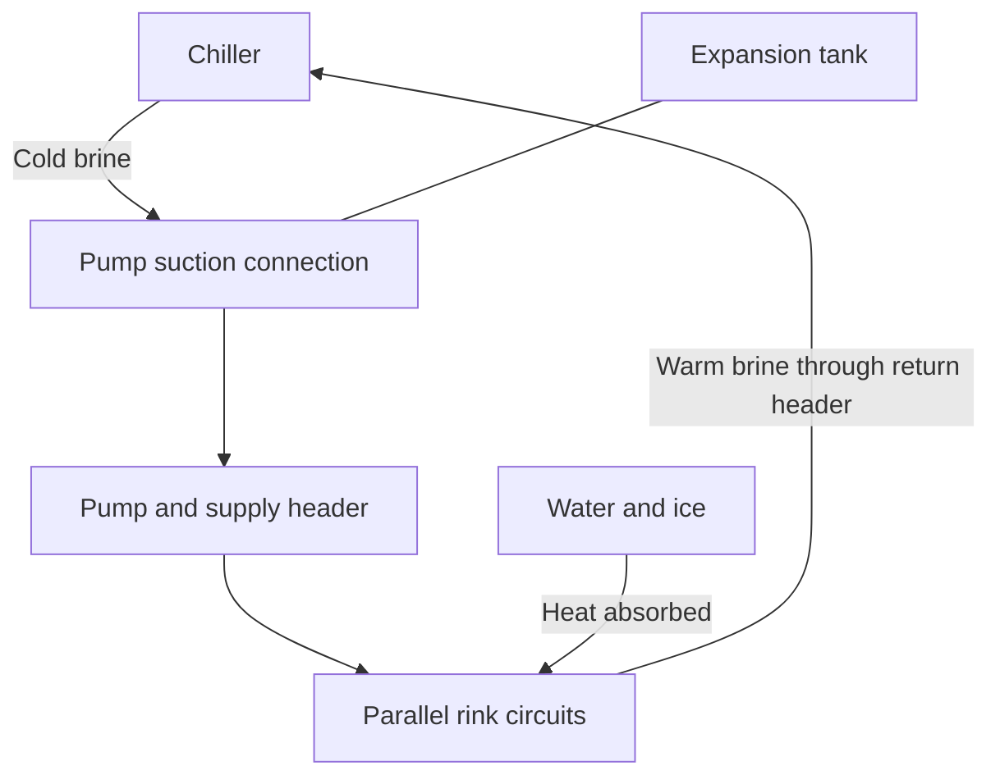

# Portable Ice Rink Design & Analysis

An ME 448 Thermal Systems Design project at Cal Poly by **Marcus Prieto and Terak Hornik**. The project investigated a portable ice rink inspired by Cal Poly's earlier rink, comparing **8-hour and 24-hour startup requirements**.

The system circulates calcium-chloride brine through rink tubing to carry heat to a chiller. The analysis links water cooling and freezing loads to brine heat transport, pressure losses, pumping, and equipment selection.

## Start here

Read **[How the ice rink system works](docs/engineering-guide.md)** for the physical loop, heat flow, calculation dependencies, component roles, team Abaqus study, and intended operation.

Functional overview only: the tank connects to the brine circuit near pump suction; see the guide for the connection and the original schematic. The chiller's refrigerant and heat-rejection circuits are separate from the brine loop.

| Read next | Purpose |
| --- | --- |
| [Design basis and assumptions](docs/design-basis.md) | Inputs, temperatures, geometry, fluid properties, and conflicting values |
| [1. Heat-load calculations](docs/calculations/01-heat-loads.md) | Water cooling, freezing, ice cooling, convection, radiation, and startup versus steady duty |
| [2. Brine, tubing, and pumping](docs/calculations/02-brine-and-pumping.md) | Circuit geometry, flow, heat transfer, pressure losses, and pump operating point |
| [3. Chiller and expansion tank](docs/calculations/03-chiller-and-expansion-tank.md) | Capacity, COP, exchanger conductance, fluid expansion, and gas acceptance volume |
| [EES variable dictionary](docs/variables.md) | Every uncommented left-hand-side variable in the three scripts, with meanings and source lines |
| [Results and reconciliation](docs/reconciliation.md) | Reported results, unresolved differences, and the path to validation |
| [Sources and engineering references](docs/references.md) | Original report locations and primary technical references |

## Project status

This is a design and simulation study. The `.txt` scripts were reconstructed from the report's printed appendices, with the original equations retained. They have **not been compiled, solved, or numerically validated in EES** during reconstruction. The original report acknowledges unresolved calculation issues and proposes physical testing as future work.

The walkthroughs explain the intended physics alongside the actual printed implementation. New worked examples are labeled illustrative. Transcription checks establish source agreement, not correctness of the equations or reported results.

## Engineering scope

- **Heat loads:** cooling water, freezing it, cooling ice to the target temperature, natural convection, and radiation exchange.
- **System modeling:** tubing heat transfer, calcium-chloride brine circulation, pressure losses, and pumping requirements.
- **Component selection:** tubing, pumps, chillers, and expansion tanks.
- **Team thermal simulation:** Abaqus steady-state modeling of the ice, concrete, insulation, and tubing region.
- **System development:** a circulation schematic and a proposed PI control concept.

## Marcus Prieto's contribution

Marcus performed **EES scripting, system modeling, and component selection**, with conceptual analysis across fluid mechanics, thermodynamics, heat transfer, and thermal systems design.

Abaqus modeling and analysis form part of the team project material. Marcus did not perform the Abaqus work.

## Repository contents

| Material | Location |
| --- | --- |
| Original project report | [Report PDF](docs/source/ME448-Project-Report.pdf) |
| Original presentation | [Presentation PDF](docs/source/ME448-Project-Presentation.pdf) |
| Heat-load script | [01_heat_loads.txt](reconstruction/report-transcriptions/01_heat_loads.txt) |
| Piping, pressure-loss, and pump script | [02_piping_pressure_and_pump.txt](reconstruction/report-transcriptions/02_piping_pressure_and_pump.txt) |
| Expansion-tank and chiller script | [03_expansion_tank_and_chiller.txt](reconstruction/report-transcriptions/03_expansion_tank_and_chiller.txt) |
| Reconstruction method and limitations | [Reconstruction notes](reconstruction/RECONSTRUCTION-NOTES.txt) |
| Unresolved source discrepancies | [Reconciliation record](reconstruction/reconstruction-issues.json) |
| Source pages, file hashes, and normalization record | [Source manifest](reconstruction/source-manifest.json) |
| Reconstructed-line references to PDF pages | [Source map](reconstruction/source-map.json) |
| Transcription verification results | [Verification record](reconstruction/verification.json) |
| Extracted appendix text and printed output screenshots | [Evidence folder](reconstruction/evidence/) |

## Reported thermal loads

The following values come from **Table 1, page 3 of the report**. They are reported thermal cooling loads, not measured electrical consumption or independently reproduced results.

| Operating condition | Reported load (BTU/hr) | Approximate refrigeration tons |
| --- | ---: | ---: |
| 8-hour startup | 69,577 | 5.80 |
| 24-hour startup | 39,594 | 3.30 |
| Steady operation, both cases | 24,602 | 2.05 |

The report's main tables and some appendix outputs differ. A lower startup cooling rate alone does not establish lower total startup energy consumption.

## Reconstructed source

The equations were recovered from these sections of the report:

| Script | Appendix | PDF pages |
| --- | --- | --- |
| Heat loads | A | 23-25 |
| Piping, pressure losses, and pumping | C | 27-29 |
| Expansion tank and chiller | E | 31-32 |

Page furniture was removed, wrapped lines were rejoined, and degree signs in comments were written as ASCII text. Printed equation tokens were preserved, including unresolved source defects. Both pypdf and pdfplumber extraction were used for comparison, and the rendered source pages were inspected visually.

EES can open `.txt` files into its Equations window; see the [official Open command documentation](https://fchart.com/ees/eeshelp/8org09.htm). The text files are sufficient for retaining and reviewing the printed equations. They do not restore the original EES project's unit settings, variable information, guesses, bounds, solver settings, or unprinted revisions.

## Questions to resolve before numerical validation

- The heat-load and piping scripts use different rink lengths: 30 ft and 35 ft.
- The report table and piping script disagree on tubing dimensions and spacing.
- A 24-hour startup load is labeled as a steady-state load in the piping script.
- Some screenshots use different inputs from the printed scripts.
- Two heat-transfer/energy-balance equations in the piping script are commented out.
- The expansion-tank script contains a visible stray `F` outside a comment.
- Unit consistency, temperature conversions, radiation balances, brine operating temperatures, and hydraulic relationships need review.

Specific observations and source pages are recorded in [reconstruction-issues.json](reconstruction/reconstruction-issues.json). Any future corrected model should retain a clear distinction between the submitted work, recovered source, and subsequent changes.

## Future work identified by the project

Physical validation of the pump and chiller; further controls development; structural and electrical analysis; setup, removal, and storage considerations; and insulation improvements. A usable capital-cost estimate also remains unresolved in the original report.

## Attribution

The original report and presentation credit **Marcus Prieto and Terak Hornik**. Reconstruction took place in November 2026 from the supplied documents. Original authorship is retained; reconstruction and documentation are subsequent work.
