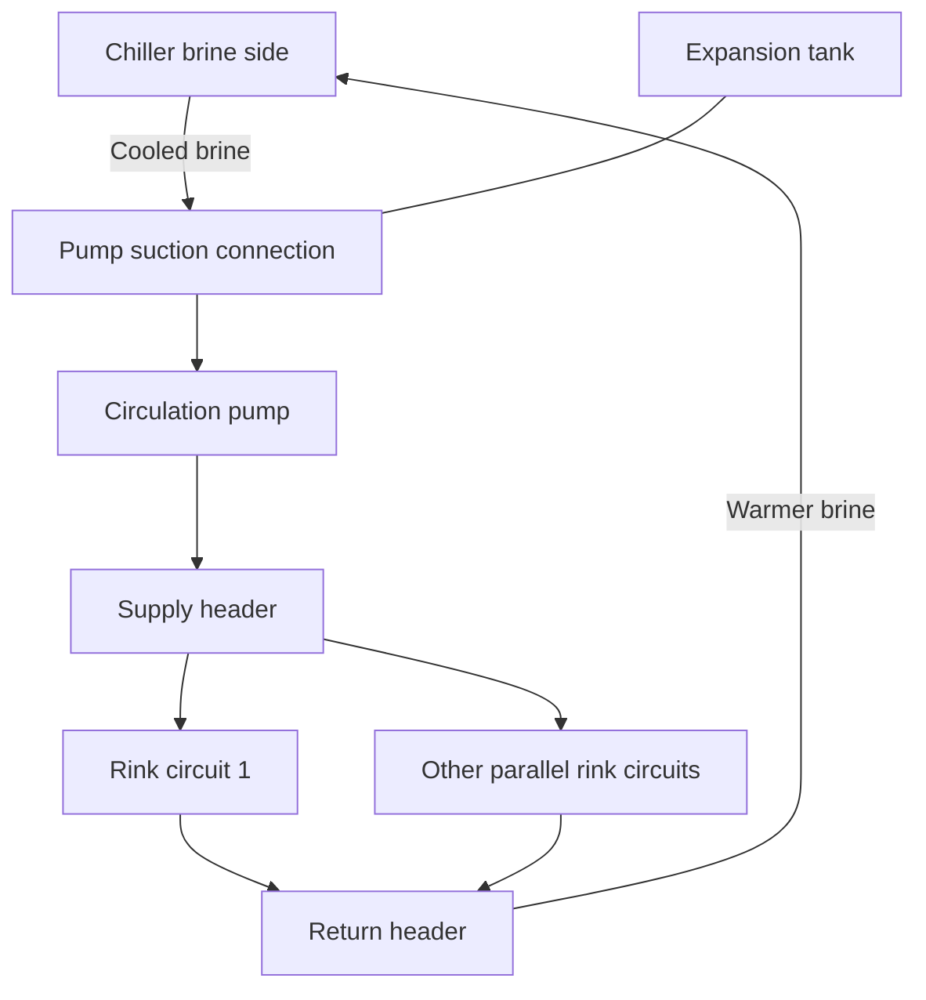
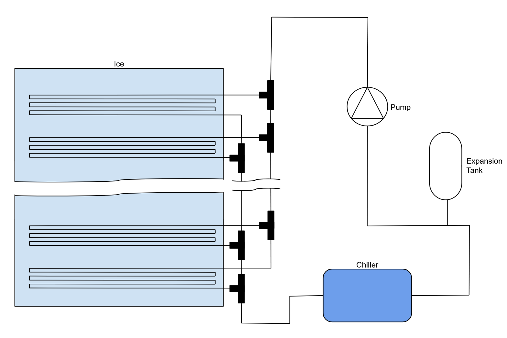
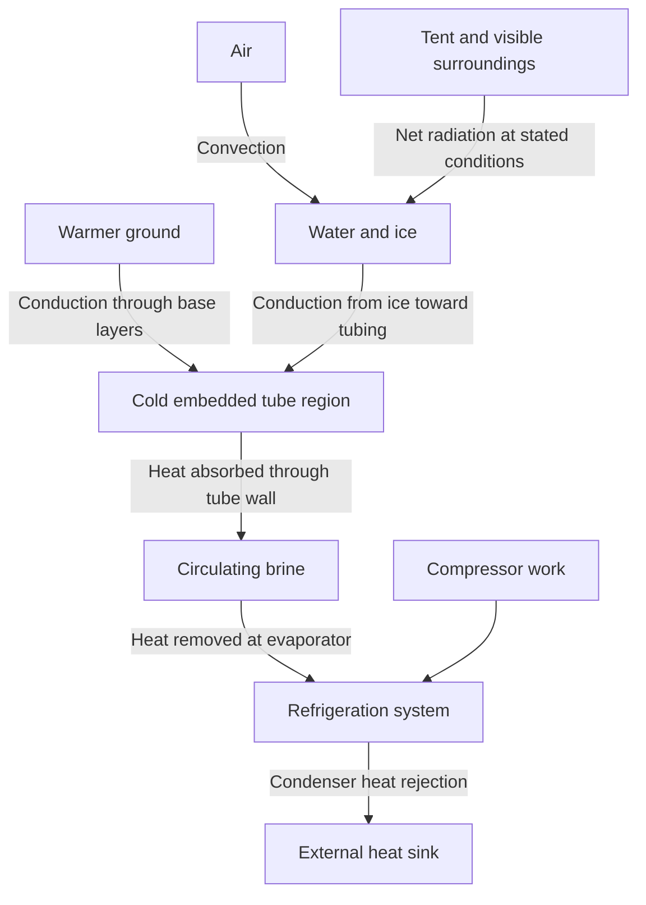
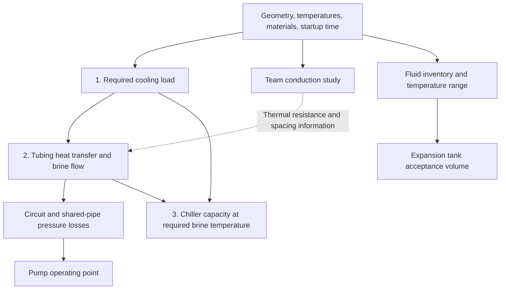
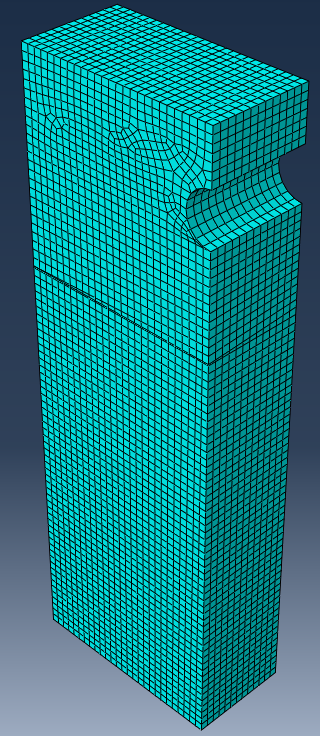
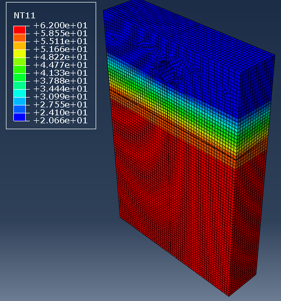
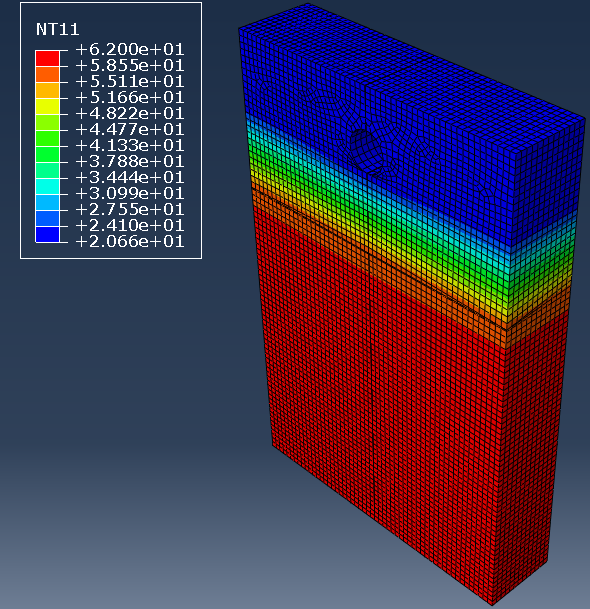

# How the ice rink system works

[Home](../README.md) · [Design basis](design-basis.md) · [Variables](variables.md) · [Open questions](reconciliation.md)

The design problem is to turn a shallow layer of water into usable ice within either 8 or 24 hours, then keep that ice cold while its surroundings continue to add heat. A circulating calcium-chloride brine carries heat from embedded rink tubing to a chiller. The pump supplies the pressure difference needed to move the brine, and an expansion tank accommodates changes in fluid volume.

This guide explains the submitted design and its governing relationships. Numerical values identified as **reported** come from the original project; **illustrative checks** are subsequent arithmetic using explicitly stated inputs. Neither establishes that the reconstructed EES scripts reproduce the report. The source files remain unchanged.

## Reading route

1. Follow the physical system and heat path below.
2. Read the [design basis](design-basis.md) for inputs and conflicting values.
3. Work through [heat loads](calculations/01-heat-loads.md), [brine and pumping](calculations/02-brine-and-pumping.md), and [chiller and expansion tank](calculations/03-chiller-and-expansion-tank.md).
4. Use the [variable dictionary](variables.md) while reading the scripts and the [reconciliation table](reconciliation.md) when a value does not agree with another source.

## The physical system

### Brine circulation

The diagram is a functional reading of the report's circulation schematic. Parallel branches are represented by two example circuits; the piping script specifies 15. Connections, balancing hardware, isolation valves, and instrumentation would need a detailed piping design.

The tank is a branch connection, not an additional series restriction carrying the full circulation flow. Within each rink circuit, several tube passes form one serpentine path. Across circuits, the flow divides between parallel paths. Consequently, the pump handles total flow, while the pressure loss calculation follows a complete supply-to-return path through one circuit plus shared piping.

The [original schematic](assets/original-system-schematic.png) is reproduced below for comparison. Source: [report](source/ME448-Project-Report.pdf), page 20, section 4.2. The repeated figure number in the report is retained in the source PDF.

### Heat movement

Heat reaches the cooled assembly through the ice surface and the base layers; ground heat can reach the embedded tubing without passing through the ice surface. The brine warms as it absorbs heat in the rink, then cools in the chiller. Inside the chiller, refrigerant passes through evaporator, compressor, condenser, and refrigerant expansion device before returning to the evaporator. That expansion device meters refrigerant; it is different from the brine expansion tank. The cycle rejects absorbed heat plus compressor work to an external sink. The report names water-cooled chillers; its brine schematic does not specify the complete condenser-water and heat-rejection installation.

Three boundaries help keep the calculations distinct:

| Boundary | Main quantity | Meaning |
| --- | --- | --- |
| Ice and supporting layers | Required heat-removal rate | Thermal load that must be carried away from the rink |
| Brine circuit | Mass flow, temperature rise, and pressure loss | How the secondary fluid transports that load |
| Refrigeration machine | Evaporator capacity and compressor input | How heat leaves the brine and is rejected outside the rink |

Pump power, compressor electrical input, and refrigeration capacity are different quantities. A refrigeration ton is a cooling rate of 12,000 BTU/hr, not a measure of electrical input.

## Requirements become calculations

This is the intended engineering dependency chain. The printed scripts are three separate equation sets, with several transferred quantities entered as constants. For example, script 2 enters a cooling load directly, and script 3 enters loop length and mass flow directly. The arrows do not claim that an automated, reconciled pipeline already exists.

### Startup and steady operation

Startup requires removal of stored thermal energy: cool the initial water, freeze it, and cool the resulting ice. The requested startup duration converts that energy into an average cooling rate. Heat arriving from the environment adds to the required rate.

During steady operation, the initial freezing requirement has passed. The refrigeration system balances continuing heat gains and other operating loads. The printed first script includes surface convection and radiation in its steady-state total; ground heat gain and other loads need an explicit accounting decision before this becomes a complete operating load model.

Table 1 on report page 3 gives:

| Condition | Reported cooling load, BTU/hr | Refrigeration tons |
| --- | ---: | ---: |
| 8-hour startup | 69,577 | 5.798 |
| 24-hour startup | 39,594 | 3.2995 |
| Steady operation, either design | 24,602 | 2.0502 |

The longer startup permits a lower cooling rate. Total energy also depends on operating duration, changing environmental gains, and machine efficiency. The report's claim of improved energy efficiency for the slower startup is not established by these rates alone; the [heat-load walkthrough](calculations/01-heat-loads.md#startup-rate-and-total-energy) explains the distinction.

## Tubing geometry links thermal and hydraulic design

Closer tube spacing changes the conduction path from the ice to the brine. Changing diameter affects internal heat transfer, velocity, pressure loss, and the quantity of tubing fluid. Changing circuit count changes the flow per branch and the path length through each branch. These decisions must be evaluated together.

Script 2 represents a 35 ft by 15 ft rink with 4-inch tube spacing, 105 cross-rink passes, and 15 parallel circuits. Seven 15-ft passes give a modeled straight length of 105 ft per circuit. Bend lengths and connection allowances are not added by that expression. The report's FEA table instead lists 3-inch spacing and a different tube diameter description. Both sets are preserved in the [design basis](design-basis.md#geometry-and-piping).

The [brine and pumping walkthrough](calculations/02-brine-and-pumping.md) explains how geometry becomes flow, heat transfer, friction, and pump requirements. Its independent geometry checks do not require uncertain brine property values.

## Why these components appear in the design

| Component | Engineering role | Calculation or selection information needed |
| --- | --- | --- |
| Embedded tubing | Conduct heat into the brine and distribute cooling | Spacing, wall conductivity, inside/outside diameters, circuit layout, temperature uniformity |
| Supply and return headers | Divide and collect flow | Total flow, branch balance, varying flow along headers, connection losses |
| Pump | Maintain circulation against losses | Flow versus head operating point, fluid properties, efficiency, suction conditions |
| Chiller | Remove heat from the returning brine | Cooling load at the required leaving-brine temperature and actual operating conditions |
| Expansion tank | Accept fluid volume changes while managing static pressure | Fluid inventory, density versus temperature, precharge, absolute pressures, usable acceptance volume |
| Sensors and actuators | Support temperature regulation and fault detection | Controlled variables, sensor locations, actuator authority, operating limits |

The report names the following equipment. These are historical selections, not confirmed procurement recommendations or verified operating points.

| Item | 8-hour design in report | 24-hour design in report | Source |
| --- | --- | --- | --- |
| Pump | Grundfos CR 15-7 | Grundfos CR 15-8 | Pages 10-12 |
| Chiller | Carrier 30XW-H | Carrier AquaSnap 30MPW | Page 13 |
| Expansion tank | Amtrol THERM-X-TROL ST-5 | Wessels FXA-100 | Page 16 image |

Selection requires matching the exact model, curve, temperature range, and fluid compatibility. Some figure captions and plotted family identifiers disagree. The report's assertions about calcium-chloride compatibility need confirmation for the actual wetted metals, seals, and membranes. A tank's nominal volume is also different from the volume of liquid it can accept between specified pressures.

## What the team Abaqus study contributes

The report's section is headed "Finite difference," but describes an Abaqus finite element study. The described setup starts from a two-dimensional cross-section, extrudes a unit depth, and partitions one composite part into ice, concrete, and insulation. A semicircular cut represents the tube boundary. The report gives an approximate global mesh spacing of 0.075 inches.

| Setup item | Reported specification | Source |
| --- | --- | --- |
| Ice boundary temperature | 24 F | Page 4 |
| Ground boundary temperature | 62 F | Page 4 |
| Tube outside boundary temperature | 20.66 F | Page 4 |
| Analysis step | Steady-state heat transfer | Pages 4-5 |
| Applied top heat flux | Startup load per area for each case | Pages 4-5 |
| Outputs | Nodal temperature, heat flux, vertical heat flux, reaction flux | Pages 6-7 |

Original Figure 1, report page 5. The mesh illustrates the modeled material region; this image alone does not establish element formulation, boundary selections, or mesh convergence.

| Reported 8-hour load case | Reported 24-hour load case |
| --- | --- |
|  |  |

Original Figure 2, report page 6. The color scale is consistent with the stated temperature boundary values. These are steady-state results under the specified load cases, not time histories of freezing over 8 and 24 hours. Prescribing an ice-surface temperature does not independently predict that the system can achieve that temperature during startup.

The report also states that both a temperature and a heat-flux load were applied to the top surface. The original model would be needed to check which nodes/faces received each condition and how reaction heat flow was interpreted. Tube spacing effectiveness would additionally need a clear temperature-uniformity criterion, energy-balance check, and mesh sensitivity study.

The full average startup duty includes changes in stored sensible and latent energy. Those changes are not incoming environmental heat flux at the top surface. Using startup duty as an imposed steady load is a surrogate loading choice; it is not a transient freezing model. In a future transient enthalpy/phase-change model, adding that stored-energy duty again as incoming surface flux would double-count the storage contribution.

Marcus performed the EES scripting, system modeling, and component selection. He did not perform the Abaqus modeling or analysis. The figures remain credited as team project material.

## Intended operation and controls

The report proposes automatic operation, pressure measurements near the pump/chiller and tank, controllable equipment, and PI feedback. It does not provide an implemented controller, tuned gains, measured response, or a completed transfer-function model. The following sequence is an explanatory operating concept for a future design, rather than a documented commissioning procedure.

1. Establish the correct fluid inventory and pressure condition, then circulate brine and confirm flow.
2. Operate the chiller to cool the water, form ice, and approach the target ice temperature within the chosen startup window.
3. Regulate maintenance cooling as continuing heat gain changes.
4. Coordinate temperature regulation with flow and pressure limits; define shutdown and restart behavior before implementation.

Temperature feedback is needed to regulate ice or brine temperature; pressure sensors by themselves do not measure that controlled variable. A future design would specify the ice/brine temperature sensors, flow confirmation, pressure limits, compressor operating constraints, and which actuator each control loop commands. PI control and any adaptive control remain concepts for further development.

## How to judge the design

The useful questions are whether the rink can meet the startup deadline, maintain acceptable ice temperatures, circulate the required flow, and reject the resulting heat at acceptable power and cost. Each answer needs a consistent set of geometry, fluid properties, temperatures, and component data.

The present record documents the methods and reported selections. The [reconciliation table](reconciliation.md) identifies the differences that prevent treating all reported outputs as one validated design. Structural integrity, electrical installation, condenser heat rejection, practical setup/storage, and physical validation remain additional development work. The report did not establish a usable capital-cost estimate.

Continue with [the design basis](design-basis.md) or [Calculation 1: heat loads](calculations/01-heat-loads.md).
